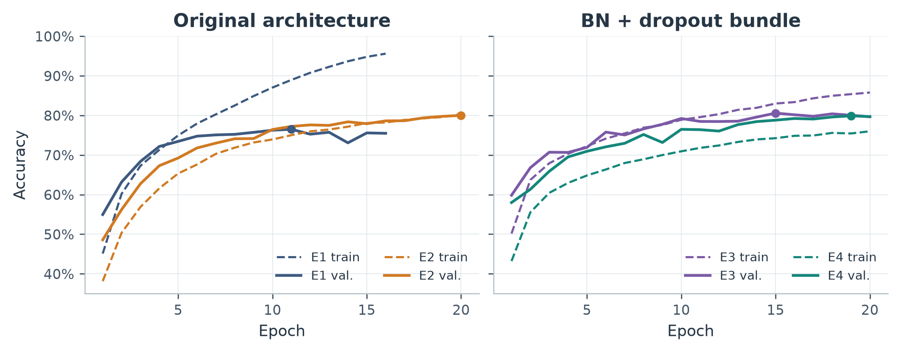
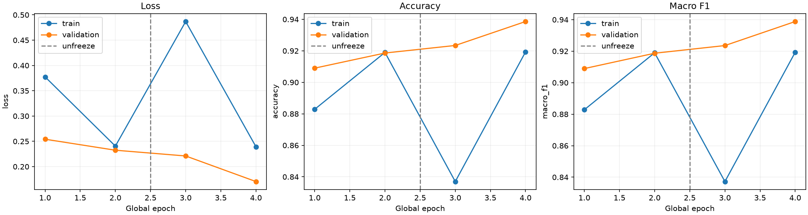
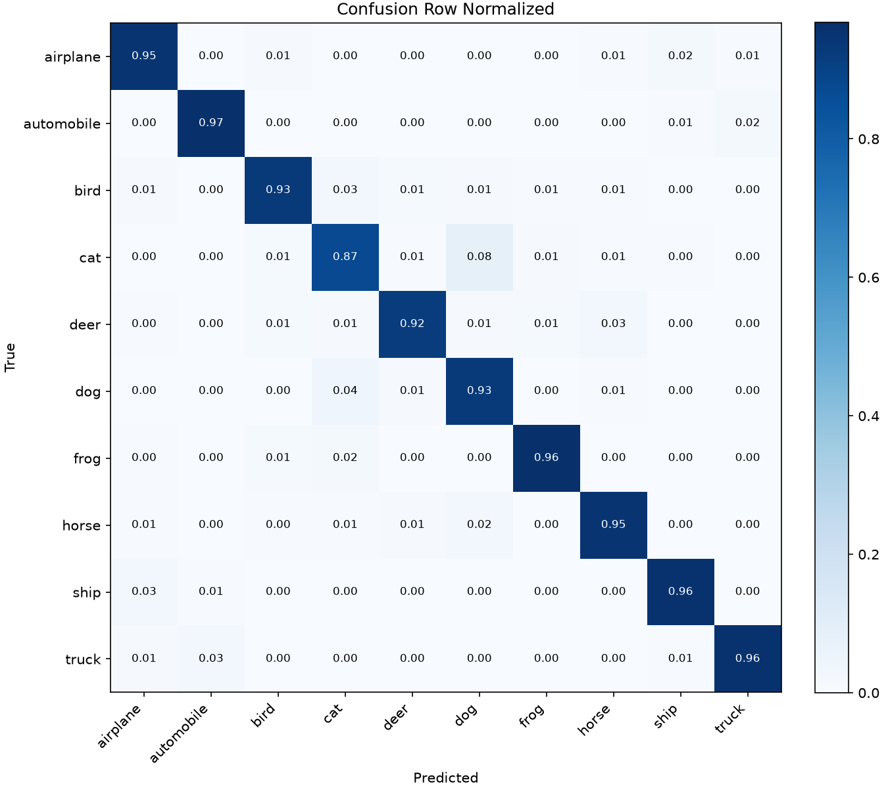

# The right model for the job

**Frontier models aren't always the best tool for the job.**

CIFAR-10 makes the tradeoff concrete: a small CNN reached **79.08%** test accuracy, and an ImageNet-pretrained ResNet-50 fine-tuned on the task reached **94.03%**. A separate zero-shot GPT-6.1 Sol pilot achieved **83/100** correct classifications. These are different evaluation protocols, so the pilot does **not** establish a head-to-head ranking against the local models.

This repository preserves the measured evidence and provides portable PyTorch reproduction code. It is an educational case study in model choice: task-specific training can be valuable, while general-purpose models offer zero-shot capability, broad applicability, and a way to avoid building a dedicated training pipeline.

## Dataset and protocols

[CIFAR-10](https://www.cs.toronto.edu/~kriz/cifar.html) contains 60,000 RGB images at 32 × 32 pixels in ten classes: airplane, automobile, bird, cat, deer, dog, frog, horse, ship, and truck. The official split has 50,000 training and 10,000 test images, with 1,000 test images per class. Convolutions exploit spatial locality and reuse learned filters across image positions.

The original CNN used all 50,000 training images for five epochs. The improved CNN and ResNet-50 reused the **same saved, stratified 45,000/5,000 training-validation split**, seed 42. Each class contributes 4,500 training and 500 validation examples. Checkpoints were selected using validation accuracy before final test evaluation. Published split indices and hashes preserve the exact assignment.

The API experiment used a **different balanced 100-image validation pilot**, ten examples per class, sampled from CIFAR-10 training data in Colab. Its exact completed prediction export and image indices were not supplied locally. The retained notebook contains sampling code, but we cannot verify that it identifies the exact externally reported pilot. Its sampling seed is 20261106; this is distinct from the local supervised split seed 42.

## Measured local results: full 10,000-image test set

| Model | Test accuracy | Macro F1 | Cat F1 | Bird F1 | Training protocol |
|---|---:|---:|---:|---:|---|
| Original CNN | 71.16% | 0.7117 | 0.542 | 0.607 | 50,000 training images, 5 epochs |
| Improved CNN | 79.08% | 0.7890 | 0.626 | 0.688 | 45,000/5,000 split, selected epoch 15 of 20 |
| Pretrained ResNet-50 | **94.03%** | **0.9404** | **0.882** | **0.936** | Same split, 2 head + 2 full fine-tuning epochs |

All three rows were checked against saved local metrics and cached logits. No full training or new full test inference was run to prepare this repository. Raw counts, normalized confusion matrices, per-class metrics, actual histories, and selection records are under [`results/`](results/). [`results/summary.json`](results/summary.json) labels provenance explicitly.

The improved CNN gained **7.92 percentage points** over the original CNN. ResNet-50 gained **14.95 percentage points** over the improved CNN on the same complete test set. This practical comparison changes pretraining, architecture, input resolution, augmentation, parameter count, and compute together; it does not isolate which intervention caused the gain.

## Models and learning behavior

The original model has three 3 × 3 convolution blocks (3→32→64→128), each with ReLU and 2 × 2 max pooling, followed by a 2,048→128→10 classifier. It has **356,810 parameters**. The improved CNN adds batch normalization after each convolution and dropout 0.3 before the first dense layer and after its ReLU, retaining convolution biases: **357,258 parameters**. Both normalize each RGB channel with mean/std 0.5.

Original training used Adam, learning rate 0.001, batch size 128, seed 42, and no augmentation. The selected improved model also used Adam 0.001 and batch 128, **without augmentation or a scheduler**, up to 20 epochs, early-stopping patience 5, strict best validation accuracy with earliest-epoch ties. Its best validation accuracy was 80.58% at epoch 15. The broader historical study compared longer training, crop/flip augmentation, BN/dropout, and combined regularization plus cosine scheduling; the BN/dropout run won validation selection. BN and dropout were a bundled intervention, not separately isolated.



*Actual train/validation accuracy for the historical controlled experiments. The original 50,000-image baseline had no saved independent validation curve. Regularization and longer training improved validation performance, but adding interventions did not monotonically improve it. This is one-seed evidence, not a universal ordering of methods.*

ResNet-50 uses torchvision ImageNet weights (`ResNet50_Weights.DEFAULT`, resolved to `IMAGENET1K_V2`) and replaces the 2,048→1,000 classifier with a 2,048→10 head: **23,528,522 parameters**. Training uses RandomResizedCrop(224), scale 0.8–1.0, ratio 0.9–1.1, horizontal flip, and ImageNet normalization. Evaluation uses the saved weight preset: resize to 232, center crop to 224. Interpolation adapts the input to the pretrained network; it cannot restore details absent from the original 32 × 32 pixels.

| ResNet-50 setting | Recorded value |
|---|---|
| Batch / seed / workers / precision | 16 / 42 / 0 / float32 |
| Optimizer | AdamW, weight decay 0.0001 |
| Stage 1 | 2 frozen-backbone epochs; head LR 0.001 |
| Stage 2 | 2 full fine-tuning epochs; backbone LR 0.00001, head LR 0.0001 |
| Scheduler / patience | Cosine per stage / 3 |
| Selection | Highest validation accuracy, earliest global epoch on ties |
| Validation accuracies | 90.90%, 91.86%, 92.34%, 93.86% |
| Recorded training wall time | 2,511.5 seconds, approximately 41.9 minutes |
| Test inference, 10,000 images | 52.2 seconds total; 48.6 seconds model forward time |
| Hardware | Apple Silicon MPS |

The frozen backbone remains in evaluation mode, including batch-normalization statistics, while the head learns. Full fine-tuning starts from the best head checkpoint with lower, separate learning rates. The training timing includes training, validation, and checkpoint work. Test total time includes loading, preprocessing, transfers, and forward passes; model timing synchronizes MPS after input transfer. These timings are specific to this setup. They are not API comparisons.



*The dashed line marks unfreezing. Validation improves through all four epochs. Online augmented training accuracy and deterministic validation accuracy use different conditions; a training accuracy drop when unfreezing is insufficient evidence of worsening generalization.*

ImageNet pretraining supplies reusable visual features before CIFAR-10 fine-tuning. Task supervision adapts those features and a closed ten-class decision boundary to this dataset. That is a plausible explanation for the strong result; this experiment did not ablate pretraining or match architecture and compute budgets to establish a causal attribution.

## Class-level errors



*Rows are true classes; columns are predictions. Each row contains 1,000 test examples. Cat remains the weakest ResNet-50 class, despite a substantial improvement over the CNN.*

The improved CNN's largest directed confusions include cat→dog (179) and dog→cat (121). ResNet-50 reduces these to **83** and **45**, respectively. Other frequent ResNet errors include ship→airplane (28), deer→horse (27), bird→cat (26), and truck→automobile (25). Animals and vehicles with related shapes remain plausible ambiguity sources, especially at this resolution; confirming that explanation would require a systematic image audit.

A representative saved mistake is test image **#2804**, cat→dog, with softmax confidence **0.9967**. Test **#4646** is bird→cat with confidence **0.9932**. High-confidence mistakes show that softmax scores are not calibrated guarantees. Exact example IDs, labels, predictions, and confidences are retained in [`results/resnet50/gallery.json`](results/resnet50/gallery.json). Generate their real image gallery locally with `plots.py`; dataset thumbnails are not redistributed in this repository.

## Separate zero-shot frontier vision pilot: 100 validation images

> **Different images, split, and sample size. Do not read the following as a controlled comparison with the full test-set table.**

| Supplied pilot result | Value |
|---|---|
| API / model / reasoning | Responses API / `gpt-6.1-sol` / medium |
| Classification | Zero-shot, one of ten fixed CIFAR-10 labels |
| Evaluation cohort | Balanced validation pilot, 100 images, ten per class |
| Accuracy | **83% (83/100)** |
| Valid answers / failed requests | 100 / 0 |
| Wilson 95% interval | Approximately 74.45%–89.11% |
| Provenance | Owner-supplied results; raw completed pilot export not available locally |

| Class | Supplied F1 | Class | Supplied F1 |
|---|---:|---|---:|
| Airplane | 0.824 | Dog | 0.750 |
| Automobile | 0.750 | Frog | 0.900 |
| Bird | 0.889 | Horse | 0.909 |
| Cat | 0.588 | Ship | 0.952 |
| Deer | 0.857 | Truck | 0.833 |

Four automobiles were reported as trucks, and four cats as dogs. Cat is also difficult for the local models, but the ten-example class supports make pilot class metrics unstable. The Wilson interval describes binomial sampling uncertainty approximately; balanced stratified sampling, unknown dependence, and prompt-development selection are additional limitations it does not resolve.

Other **exploratory ten-image smoke tests** were reported as GPT-6.1 Sol 9/10, GPT-5.6 Sol 8/10, GPT-5.4 mini 6/10, and GPT-5.4 4/10. They do not support reliable model rankings. API latency, token usage, and dollar costs were **not supplied**, so no measured values are claimed. Model identifiers are retained as reported historical experiment identifiers; current endpoint availability is not asserted.

The retained [`Responses Colab notebook`](notebooks/cifar10_responses_colab.ipynb) sends original 32 × 32 PNG images and requests a single structured class label. It retrieves `OPENAI_API_KEY` from Colab Secrets, separates development from test stages, caches classifications, handles retries, and defaults to paid calls disabled with a conservative call cap. All execution outputs were cleared for publication. The notebook's local validation fixtures were mocked tests, not actual model predictions, and are excluded from measured results. Price tables in the notebook are dated estimates, not measured pilot costs; verify them before execution.

The frontier pilot required no CIFAR-10 training. General-purpose multimodal models may be attractive for changing labels, broader visual reasoning, small-data tasks, and rapid prototyping. The local models instead required labeled data, training compute, and a narrowly defined output space. The presented evidence supports investigating the right tool for a deployment, not a claim that frontier models are inherently inferior or that the task-specific model is always cheaper or faster.

## Reproduce the local experiments

Use **Python 3.12** (historical interpreter: 3.12.13). No API key or external service is needed for the local experiments. CIFAR-10 is downloaded automatically through torchvision on first use; ResNet training also downloads the ImageNet weights. For a CUDA-specific PyTorch build, follow the [official installation selector](https://pytorch.org/get-started/locally/) for your platform and record any version change.

```sh
python3.12 -m venv .venv
source .venv/bin/activate
python -m pip install -r requirements.txt
python -m unittest discover -s tests -v
python train.py --help
python evaluate.py --help
```

Run from the repository root. `auto` chooses CUDA, then MPS, then CPU; pass `--device mps`, `--device cuda`, or `--device cpu` explicitly when needed. Outputs go to a **new, empty run directory**. Downloaded images are stored under `data/`, and run outputs and weights under `runs/`, both ignored by Git.

```sh
# Original fixed five-epoch model; all 50,000 training images, no validation.
python train.py --config configs/original.json --output runs/original
python evaluate.py --run runs/original

# Improved CNN; saved 45,000/5,000 split, validation selects the checkpoint.
python train.py --config configs/improved.json --output runs/improved
python evaluate.py --run runs/improved

# ImageNet-pretrained transfer learning; 2 head + 2 fine-tuning epochs.
python train.py --config configs/resnet50.json --output runs/resnet50
python evaluate.py --run runs/resnet50

# Historical image examples, no model inference needed.
python plots.py --metrics-dir results/resnet50 --output runs/historical_errors.png
```

Use `--data-dir PATH` to reuse an existing torchvision dataset and `--no-download` to forbid downloads. The ResNet run can be slow on CPU. Recorded MPS training was 41.9 minutes with batch 16; this is not a portable runtime guarantee. The saved one-hour budget includes a five-minute evaluation reserve; the portable runner checks the budget between complete epochs, so a slow first epoch can overrun it. Stop before launching a full run if your hardware budget is insufficient. A `--smoke-max-batches 1` training run is explicitly labeled non-comparable and must use its own output directory.

Training writes `config.json`, `environment.json`, `history.json`, selected `best.pt`, `selection.json`, and learning curves. It does not evaluate the test set. Evaluation checks the selected checkpoint/configuration hashes, caches one complete test pass, and writes metrics, class CSV, predictions, confusion plots, timing, and errors. Re-running evaluation reuses the prediction cache. A recorded incomplete test pass refuses automatic retry and requires explicit reconciliation.

The source architectures, preprocessing, and hyperparameters were preserved in the portable implementation. Administrative paths and the old report helper's AST extraction were replaced with direct local utilities. This runner does not implement the historical ResNet runner's mid-run resume or short throughput benchmark. Changing a configuration creates a new experiment; historical results are not a guarantee of the exact output of a rerun, especially across MPS/CUDA/CPU kernels or package versions. Large trained checkpoints are not published; reproduce them by training. Historical checkpoint SHA-256 values and exact split hashes are retained for local verification.

## Limitations and fairness

- Local models and the API pilot used unequal cohorts and training access. A fair head-to-head needs identical held-out image IDs and a frozen prompt.
- This is one supervised seed/split and one small reported pilot. Prompt development and small-sample uncertainty limit generalization of the API result.
- Architecture, ImageNet pretraining, augmentation, input size, and compute change together. Neither the CNN/ResNet difference nor the unequal pilot establishes isolated causal effects.
- CIFAR-10 is a public, widely studied dataset. Pretraining overlap or benchmark familiarity cannot be excluded for ImageNet weights or frontier models. Zero-shot here means no task-specific fine-tuning during this experiment, not proof the model never saw CIFAR-10.
- 32 × 32 images discard detail. Resizing cannot create lost visual evidence. Fixed categories also make this narrower than general visual reasoning.
- A local forward pass has no per-request API fee, but hardware, energy, training, maintenance, and deployment still cost resources. No measured API latency/cost comparison is available.
- The improved CNN and ResNet-50 test results followed validation-based selection; the original CNN used its fixed final epoch without validation. Broader conclusions need replicated seeds and a genuinely new evaluation cohort.

## Future experiments

1. **Vision Transformers:** fine-tune pretrained ViT-Base or ViT-Large on the same split and test protocol. Compare against the CNN and ResNet with explicit compute budgets. Explore LoRA or singular-value fine-tuning (SVFit) as parameter-efficient adaptation experiments.
2. **Controlled frontier comparison:** freeze the prompt, evaluate the frontier model and ResNet-50 on identical images, retain paired predictions, and measure accuracy, error overlap, latency, usage, and actual API charges. Expand the sample or use all 10,000 test images where practical.
3. **Hybrid inference:** route uncertain local predictions to a frontier model, using validation data to set the threshold. Measure whether it corrects more errors than it introduces and plot accuracy against added latency and measured API cost.

These are proposals, not completed results. The current study demonstrates strong task-specific transfer learning and motivates a controlled follow-up; it does not establish a universal winner.

## Attribution and license

CIFAR-10 was created by Alex Krizhevsky, Vinod Nair, and Geoffrey Hinton. Cite Alex Krizhevsky, *Learning Multiple Layers of Features from Tiny Images*, technical report, University of Toronto, 2009, as requested by the [dataset page](https://www.cs.toronto.edu/~kriz/cifar.html). ResNet-50 uses torchvision's implementation of [Deep Residual Learning for Image Recognition](https://arxiv.org/abs/1512.03385); weight and preprocessing details are documented by [torchvision](https://docs.pytorch.org/vision/0.25/models/generated/torchvision.models.resnet50.html).

Only aggregate original plots, numeric metrics, and split indices are included. No downloaded images, trained checkpoints, or embedded dataset thumbnails are redistributed. The dataset page does not supply a blanket image license that we can apply as the project's code license. Any future code license will not relicense third-party datasets or weights.

**Code license: owner selection pending.** No open-source license grant is implied until the owner chooses one. See [`AGENTS.md`](AGENTS.md) for contribution and experiment-integrity rules.
